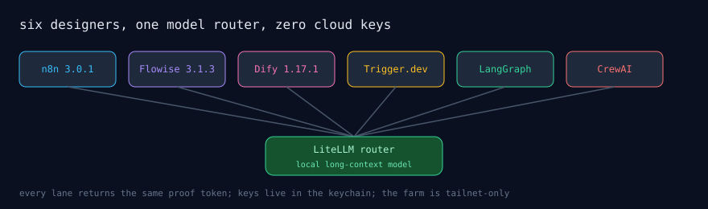

# agentic-workflows

The same hello-agent, built once per designer, run across six agentic workflow
tools: **n8n, Flowise, Dify, Trigger.dev, LangGraph (MIT core), CrewAI**. All
six are self-hosted on one machine, all six call the same local model through a
LiteLLM router, and every lane returned the same proof token. Zero cloud API
keys were involved in any of the runs.

Why a repo of hello-worlds matters: the point is not the agent, the point is
the comparison. Every designer is deployed from the compose files in its
directory, every run is witnessed by the checked-in JSON in `results/`, and
the whole estate is driven through one 235-line MCP server so an AI assistant
operates all six through one surface (`mcp/agentic_mcp.py`, keys read from the
OS keychain, values never printed).



## Verify the claim without deploying anything

```bash
grep -h "HELLO-AGENT" results/*.json   # five lanes echo their token
```

`results/n8n-run.json` records the webhook kick and the execution status
instead of an echoed token (n8n's webhook returns "Workflow was started",
and the execution log holds the model output).

## Layout

| Directory | What it is |
|---|---|
| `designers/n8n/` | n8n 3.0.1 compose; workflow `Hello Agent RIG proof` (exported in the run proof) |
| `designers/flowise/` | Flowise 3.1.3 compose; Agentflow v2 proof flow |
| `designers/dify/` | Dify 1.17.1; workflow + advanced-chat apps defined in-console, run proofs checked in |
| `designers/trigger/` | Trigger.dev self-hosted webapp compose (+ ClickHouse, Postgres, Redis, MinIO) |
| `designers/langgraph/` | LangGraph MIT core server: the agent graph (`app/agent.py`) and its serve config |
| `designers/crewai/` | CrewAI FastAPI service: the crew (`app/crew.py`) and its server |
| `mcp/agentic_mcp.py` | one stdio MCP server, six designers, scoped keychain reads |
| `scripts/` | env generation (keychain → compose env file) and deploy orchestration |
| `results/` | the run evidence, HTTP-level, per designer |

## Standing up your own

```bash
./scripts/deploy.sh            # compose up the six designers (docker required)
./scripts/generate-env.sh      # build the env file from OS keychain entries
```

Point the LiteLLM router (or any OpenAI-compatible endpoint) at a model, set
`OPENAI_BASE_URL`, and the same hello-agent runs in each lane.

## Honest limits

- The five proof tokens were produced against one local model
  (`long-context-local` alias); quality of the replies reflects that model,
  not the designers.
- n8n and Flowise store their definitions in their own databases; the
  directories here hold the deployment, and the proofs hold the flow
  identifiers. Full node-level exports per flow are in the works.
- LangGraph Studio and LangSmith hosted need licenses; this farm runs the MIT
  core server only.

Part of the [mrodgersjs-web](https://github.com/mrodgersjs-web) FDE studio fleet — control planes, gates, fleets, proof. [rodgersintelligence.com](https://rodgersintelligence.com)
